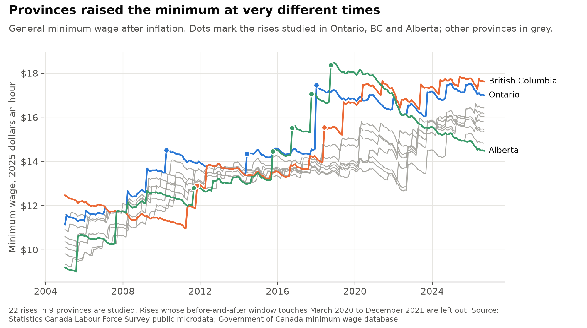
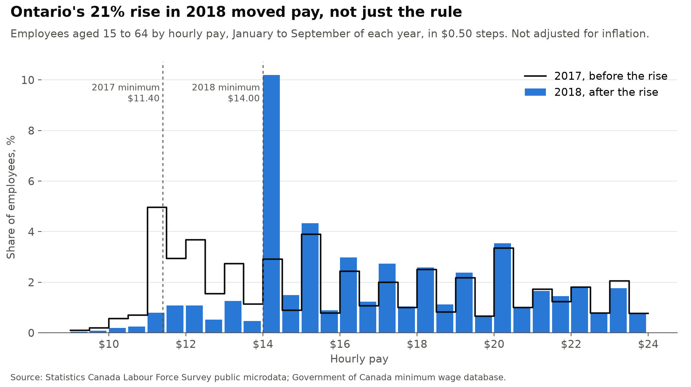
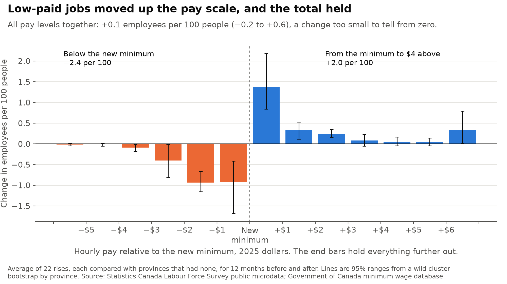
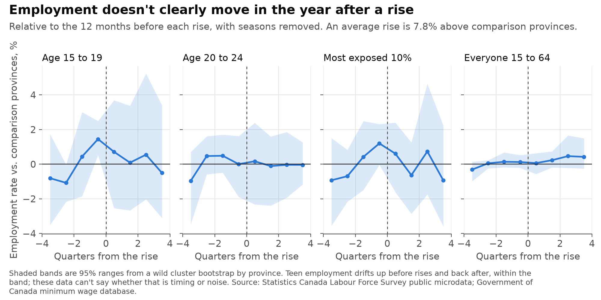
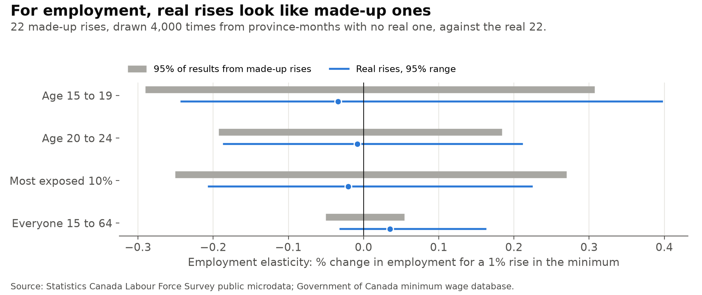
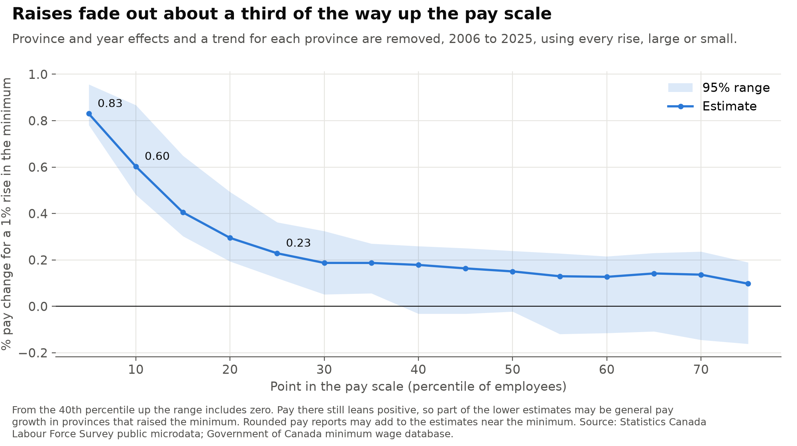
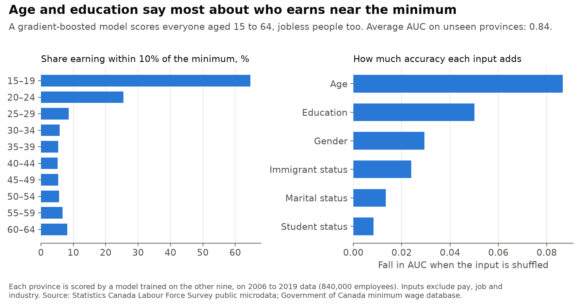
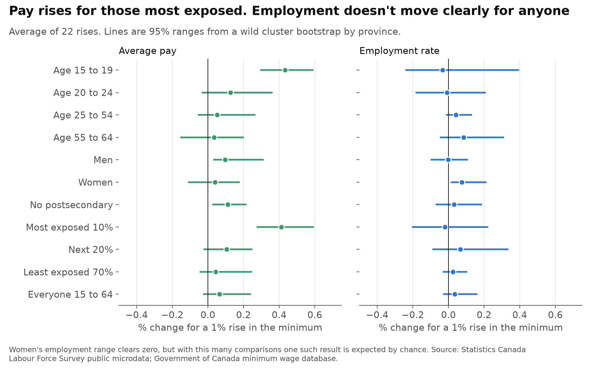

# canada_minimum_wage

[](https://github.com/atamalfuzi/canada_minimum_wage/actions/workflows/tests.yml)

What minimum wage rises did to pay and jobs in Canada, from 2006 to September 2026, using 20 million public survey records of people aged 15 to 64. Provinces raise their minimums at different times, so each large rise can be compared with provinces that had none. Python, with pandas and scikit-learn.

**[Write-up with interactive charts](https://atamalfuzi.github.io/canada-minimum-wage.html).** Results are as of October 2026, with data through September 2026.

**[Live dashboard](https://atamalfuzi.github.io/canada_minimum_wage/)**, rebuilt on the 25th of each month from Statistics Canada's newest Labour Force Survey file: each province's general minimum and any announced rate, pay around the minimum, the share of employees near or below it, the minimum after inflation, and teen and overall employment against the same month a year earlier. Those figures describe one month and don't show why anything changed. The study's main estimates are re-run with all data to date and shown separately, so they can drift a little from the numbers below.

> **Personal project.** This is my own analysis of publicly available data. It is not associated with my work for any current or past employer and does not represent their views.

| Question | Methods | Answer |
|---|---|---|
| [Where do low-paid jobs go?](#1-where-do-low-paid-jobs-go) | Bunching estimator, stacked difference-in-differences | Up the pay scale. Jobs below the new minimum fall by 2.4 per 100 people; total employees change by +0.1 (−0.2 to +0.6). |
| [Do jobs and hours fall?](#2-do-jobs-and-hours-fall) | Event study, wild cluster bootstrap, placebo rises | No clear change. A 10% rise moves teen employment by −0.3% (−2.4% to +4.0%). |
| [How far up do raises reach?](#3-how-far-up-do-raises-reach) | Percentile panel with province trends | About a third of the way. A 1% rise lifts pay 0.83% at the 5th percentile, 0.60% at the 10th and 0.23% at the 25th. |
| [Who is affected most?](#4-who-is-affected-most) | Gradient boosting on demographics, subgroup estimates | The most exposed 10%, nearly all under 25: pay up 4.1% per 10% rise, employment −0.2% (−2.1% to +2.2%). |

## What it shows



The study covers 22 rises in 9 provinces. An average rise is 7.8% above its comparison provinces. Ranges are 95%.

### 1. Where do low-paid jobs go?



Ontario's jump from $11.60 to $14.00 in January 2018 is the clearest case. Compared with provinces that had no large rise, jobs below the new minimum fell by 7.3 per 100 people aged 15 to 64, jobs from the minimum to $4 above rose by 5.4, and all employees together changed by −0.1.



Across all rises, jobs below the new minimum fell by 2.37 per 100 people (1.77 to 3.25), and jobs from the minimum to $4 above rose by 2.04 (1.50 to 2.84). That is 86% of the jobs lost below. The other 0.33 per 100 is not simply gone: pay further up rose by 0.44 (0.08 to 0.92), and all employees together changed by +0.11 (−0.20 to +0.57). This window can't say whether those higher jobs are the same workers or just pay growth, so the total is the number to rely on.

### 2. Do jobs and hours fall?



| Group and outcome | Change for a 1% rise in the minimum | 95% range |
|---|---:|---:|
| Teen employment | −0.03% | −0.24 to 0.40 |
| Teen hours per person | −0.06% | −0.31 to 0.58 |
| Employment, ages 20 to 24 | −0.01% | −0.19 to 0.21 |
| Employment, everyone 15 to 64 | 0.03% | −0.03 to 0.16 |
| Jobs in accommodation and food, per person | −0.05% | −0.45 to 0.38 |
| Jobs in retail, per person | 0.04% | −0.25 to 0.43 |



To test the method, I drew 22 made-up rises from province-months with no real one, 4,000 times. For teens, 95% of those results fall between −0.29 and 0.31, so a real effect smaller than about that can't be told apart from noise. These data rule out large teen job losses, but not small ones.

Other ways of asking the same question:

| Check | Rises | Teen employment | 95% range |
|---|---:|---:|---:|
| All rises | 22 | −0.03 | −0.24 to 0.40 |
| Real rise of at least 6% | 10 | −0.15 | −0.40 to 0.29 |
| Comparison provinces rose under 2% | 19 | −0.06 | −0.36 to 0.46 |
| One step in the 12 months after | 12 | −0.10 | −0.86 to 0.47 |
| Annual panel using every rise, with province trends | all | −0.09 | −0.49 to 0.39 |
| Same annual panel without 2020-21 | all | −0.01 | −0.37 to 0.40 |
| Dropping any one province | 17 to 21 | −0.07 to 0.04 | |

The range widens with fewer rises, and the strongest rises lean more negative. For everyone aged 15 to 64 the annual panel gives 0.04 (−0.05 to 0.16), or 0.05 (−0.02 to 0.16) without 2020-21.

### 3. How far up do raises reach?



A 1% higher minimum lifts pay by 0.83% at the 5th percentile (0.78 to 0.96), 0.60% at the 10th (0.48 to 0.87) and 0.23% at the 25th (0.12 to 0.36). From the 40th percentile the range includes zero. The flat 0.13 to 0.14 near the top suggests that part of the lower numbers is general pay growth in the same provinces, not the minimum itself.

These estimates use every year from 2006 to 2025, including 2020 and 2021, when low-paid job losses changed who was left in the pay scale. That change isn't a minimum wage effect, so I reran the panel without those two years. It gives 0.82% at the 5th percentile (0.76 to 0.95), 0.60% at the 10th (0.46 to 0.87) and 0.23% at the 25th (0.10 to 0.37), and the range still includes zero from the 40th. No percentile moves by as much as 0.02, so the numbers above stay as the main ones.

### 4. Who is affected most?



People without a job have no pay to measure, so looking only at low-paid workers would miss anyone who lost a job. A gradient-boosted model trained on demographics alone scores everyone aged 15 to 64 on how likely they are to earn within 10% of the minimum. Each province is scored by a model trained on the other nine, with an average AUC of 0.84. The most exposed 10% turn out to be 84% teens and 14% aged 20 to 24, so here the model mostly confirms what age already says.



The most exposed 10% see average pay rise 0.41% per 1% rise (0.27 to 0.59), close to teens at 0.43% (0.29 to 0.59). Their employment moves by −0.02 (−0.21 to 0.22) and hours per person by −0.10 (−0.32 to 0.24). Within this group, jobs below the new minimum fall by 8.6 per 100 people and jobs just above rise by 8.6. Women's employment is the one range clear of zero, but among this many comparisons one such result is expected by chance.

## Method

**Which rises count.** A rise counts if the 12 months from it pay at least 4% more, after inflation, than the 12 months before, and the rise itself is at least 3%. When two fall within a year, the larger one is kept. Rises whose window touches March 2020 to December 2021 are dropped.

**Comparison provinces.** Each rise is compared with the average of provinces whose minimum rose less than 3% over the same window. At least two are required, which leaves Manitoba with no rise of its own in the study and thins out 2008-2010, when many provinces moved at once.

**Bunching estimator.** Employees per 100 people aged 15 to 64 are counted in $1 steps of real pay around the new minimum, before and after, against the same pay levels in the comparison provinces. This follows Cengiz, Dube, Lindner and Zipperer (2019).

**Elasticities.** The change in log employment, hours or pay against the rise in the log minimum, across all rises, through the origin.

**Ranges.** With about ten provinces, ordinary clustered errors are far too narrow. Ranges come from a wild cluster bootstrap by province with Webb weights, inverted into a 95% range.

**Pay scale.** Weighted percentiles of real pay by province and year, regressed on the log minimum with province and year effects and a straight-line trend for each province. Unlike the rises, whose windows avoid March 2020 to December 2021, this panel and the annual jobs panel keep all of 2020 and 2021. Reruns without those years are in `output/spillovers_no_2020_21.csv` and `output/panel_elasticities_no_2020_21.csv`.

**Survey.** The public files have no person identifier, so these are repeated samples of people, not the same people followed over time. Rates use the survey's final weights, and the minimum for a month is the rate in force on the 15th, because the survey's reference week holds the 15th.

## Limits

- Twelve months is short. Jobs that adjust over several years, through fewer new businesses or more automation, won't show up here.
- Comparison provinces overlap across rises, and a province can hit its own shock at the same time. Alberta's rises came alongside the 2015-16 oil slump, though dropping Alberta leaves the result about the same.
- Pay is self-reported and often rounded. Lower legal rates for students and, in some provinces, liquor servers mean some reported pay below the minimum is legal.
- Provinces raise the minimum when they choose to, often in good times. Province trends help but don't remove this.
- Teen employment drifts up before rises and back after. It stays inside the range, but with these data I can't tell if that is timing or noise.

## Data

| Data | Source |
|---|---|
| Labour Force Survey public use microdata, 2006 to September 2026 | [Statistics Canada, 71M0001X](https://www150.statcan.gc.ca/n1/pub/71m0001x/71m0001x2021001-eng.htm) |
| General hourly minimum wage rates since 1965 | [Government of Canada minimum wage database](https://minwage-salairemin.service.canada.ca/en/since1965.html) |
| Consumer price index, all items, Canada | [Statistics Canada table 18-10-0004-01](https://www150.statcan.gc.ca/t1/tbl1/en/tv.action?pid=1810000401) |

The minimum wage database's general-rate flag misses five rows and one BC row has the wrong year. Both are corrected in `data.py`, with tests.

Adapted from Statistics Canada; this does not constitute an endorsement by Statistics Canada of this product. Contains information licensed under the Open Government Licence - Canada.

## Run it

Python 3.12:

```
python -m venv .venv
.venv\Scripts\activate          # Windows; on macOS or Linux: source .venv/bin/activate
pip install -r requirements.txt
python data.py
python panels.py
python estimate.py
python checks.py
python figures.py
python site_data.py
```

Run them from the repository folder, in this order. `data.py` downloads about 640 MB into `data/` and later runs reuse those files. Once downloaded, the rest takes about 7 minutes. Results reproduce exactly on the same data. Delete `data/` to fetch the latest files. The study runs through the newest month both the survey and the CPI reach, so results change when newer files are fetched.

To build the dashboard, run `python dashboard.py` after `data.py`, `panels.py` and `estimate.py`. It writes a static site to `site/` and stops without writing if the latest survey, CPI or minimum wage data have gaps or implausible values, including new rows in the minimum wage database with the errors it has had before. The [dashboard workflow](.github/workflows/dashboard.yml) does the same on GitHub Actions on the 25th of each month and publishes to GitHub Pages only if every step passes. The 25th comes after both the survey file (between the 4th and 13th) and that month's CPI (as late as the 24th).

To run the tests: `pip install -r requirements-dev.txt`, then `pytest`. They use made-up data and need no downloads.

## License

Code: [MIT](LICENSE).
